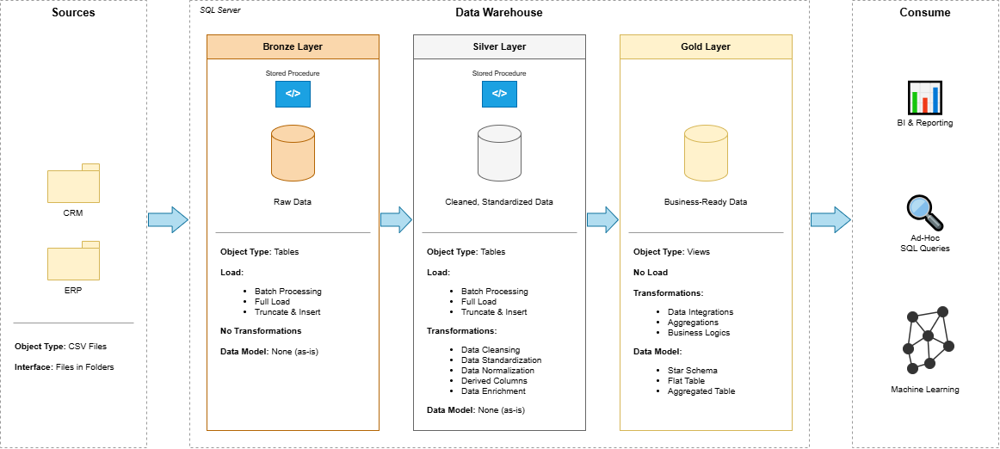

## Data Warehouse and Analytics Project

This project demonstrates a comprehensive data warehousing and analytics solution, from building a data warehouse to generating actionable insights. Designed as a portfolio project, it highlights industry best practices in data engineering and analytics.

## Project Overview
This project involves:
1. **Data Architecture**: Designing a Modern Data Warehouse using Medallion Architecture Bronze, Silver and Gold layers.
2. **ETL Pipelines**: Extracting, transforming and loading data from source systems into the warehouse.
3. **Data Modelling**: Developing fact and dimension tables optimized for analytical queries.
4. **Analytics & Reporting**: Creating SQL-based reports and dashboards for actionable insights.

## Tech Stack

**Database Engine:** [SQL Server Express](https://www.microsoft.com/en-us/sql-server/sql-server-downloads) — lightweight server for hosting your SQL database

**Language:** SQL (DDL, DML, Window Functions, Aggregations)

**Diagrams:** [draw.io](https://www.drawio.com/) — used to design data architecture, models, flows, and diagrams

**Version Control:** [Git](https://git-scm.com/) & [GitHub](https://github.com) — used to manage, version, and collaborate on the code

**Project Management:** [Notion](https://www.notion.so/) — see the full [project plan and task breakdown](https://app.notion.com/p/DThe-Notion-Basics-3d1a24c39da18051806ef44c1df618a2?source=copy_link) here

## Project Requirements
**Building the Data Warehouse (Data Engineering)**

**Objective**

Develop a modern data warehouse using SQL Server to consolidate sales data, enabling analytical reporting and informed decision making.

**Specifications**

**. Data Sources:** Import data from two source systems (ERP and CRM) provided as CSV files.

**. Data Quality:** Cleanse and resolve data quality issues prior to analysis.

**. Integration:** Combine both sources into a single, user-friendly data model designed for analytical queries. 

**. Scope:** Focus on the latest dataset only; historization of data is not required.

**. Documentation:** Provide clear documentation of the data model to support both business stakeholders and analytical teams.

## BI: Analytics & Reporting (Data Analytics)

**Objective**

Develop SQL-based analytics to deliver detailed insights into:

**. Customer Behavior**

**. Product Performance**

**. Sales Trends**

These insights empower stakeholders with key business metrics, enabling strategic decision-making.

## Data Architecture (Medallion Structure)
The data flows through three distinct layers to ensure data quality and integrity:




**Bronze:**	Raw	Source files loaded as-is from CRM and ERP (CSV)

**Silver:**	Cleaned & conformed	Duplicate removal, filtering, standardisation, handling missing values, transformations, enrichment

**Gold:**	Business-ready	Star schema views for analytics and reporting

## How to Run the Scripts
To execute this pipeline and build the data warehouse layers locally, follow these steps:

1.**Prerequisites:** Ensure you have **Microsoft SQL Server** and **SQL Server Management Studio (SSMS)** installed and running.

2.**Clone the Repository:** Clone this project to your local machine using Git or download it as a ZIP file.

3.**Database Setup:** Open SSMS, connect to your server instance, and create a new target database for this project.

4.**Execute Transformations:** Navigate to the '/scripts' folder in this repository. Open and execute the SQL scripts sequentially inside SSMS:
  * Execute the staging scripts to prepare your raw **Bronze** tables.
  * Execute the transformations queries to build your conformed **Silver** tables.
  * Execute the final analytical queries to populate the aggregated business metrics in your **Gold** layer.
    
## Repository Structure

```
data-warehouse-project/
│
├── datasets/                          # Raw datasets used for the project (ERP and CRM data)
│
├── docs/                              # Project documentation and architecture details
│   ├── etl.drawio
│   ├── data_architecture.drawio
│   ├── data_catalog.md
│   ├── data_flow.drawio
│   ├── data_models.drawio
│   ├── naming-conventions.md
│
├── scripts/
│   ├── bronze/
│   ├── silver/
│   ├── gold/
│
├── tests/
│
├── README.md
├── LICENSE
├── .gitignore
└── requirements.txt
```


